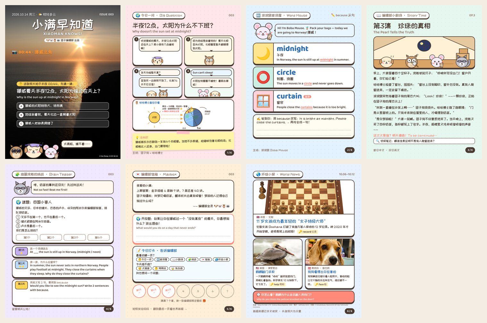

# 团子编辑部 · Kids Magazine Kit

给自己的孩子做一份**每日中英双语杂志**：AI 编辑部每天出一期，封面是一张会让孩子"咦？"的真实照片，后面是 4 格漫画讲原理、单词卡、推理连载、奥数小谜题、信箱和环球小报。适合 7–11 岁，15 分钟读完，可以发微信，也可以打印出来写。

A daily Chinese–English magazine for one child, written by an AI "editorial team" and rendered to PNG + PDF. Parents describe their kid in a questionnaire; the agent does the labour.



> 示例里的读者「小满」是虚构的孩子。

## 它是怎么工作的

**家长掌握对孩子的了解，AI 负责干活。**

1. 家长填一份问卷 `MY_CHILD.md`：孩子是谁、喜欢什么、想让孩子吸收什么、杂志用什么语气
2. agent（Claude Code / Codex 等）按 `SKILL.md` 的规则每天出一期：找封面照片、核实科学事实、挑本周适合孩子的新闻、写漫画和连载、画原理图解，然后渲染成图片
3. 信箱页的"今日打卡"让孩子圈出最喜欢哪页、难不难、还想问什么；家长拍照发给 agent
4. 每周日"做本周策展"：agent 汇总反馈，给出下周的调整建议，家长确认后才改

## 每期内容

| 页 | 内容 |
|---|---|
| 封面 | 满版真实照片 + 反直觉问题 + 三选一"先猜一猜"，编辑部成员按主题换表情和道具 |
| 今日一问 | 4 格漫画讲清一个机制 + agent 画的原理图解 + 冷知识便利贴 |
| 单词屋 | 3 张单词卡，按孩子的英文档位选词，例句带语法点，留写字格 |
| 小剧场 | 编辑部推理连载，单集中文、双集英文，带"侦探笔记"提问 |
| 挑战 | 逻辑谜题 + 英文三关（填空 / 阅读 / 写作）|
| 信箱 | 回信、开放题、今日打卡、集章 |
| 环球小报 | 本周 3 条适合孩子的真实新闻，交叉核实来源 |
| 讲读版（可选）| 7 张图配分角色朗读，英文单词和故事带慢速跟读；讲读脚本的规则见 `SKILL.md`「讲读版」，用什么工具合成由 agent 自己决定 |

## 快速开始

需要：Node 22+、Chrome（或 Chromium），以及一个能读写文件的 AI agent。

```bash
git clone https://github.com/jevejoze/kids-magazine-kit
cd kids-magazine-kit

# 渲染示例期刊，看看效果
node scripts/render.mjs examples/demo/issues/003.json output
# → output/issue-003/card-1..7.png 和 PDF
```

给自己的孩子用：

```bash
cp -r templates/data data        # data/ 已在 .gitignore 里
```

1. 打开 `data/MY_CHILD.md` 填问卷。越具体越好：「喜欢猫，尤其是橘猫，问过猫为什么会呼噜」比「喜欢动物」好用得多
2. 在本目录打开 agent，说：**"按问卷给孩子建刊"**
3. 之后每天说：**"出下一期"**

常用指令：

| 说 | agent 会 |
|---|---|
| 出下一期 / 做第 N 期 | 读资料、找素材、写内容、渲染、自检 |
| 记一笔：她今天盯着封面看了很久 | 原话记进 `curation-log.md` |
| 做本周策展 | 汇总本周反馈，出调整建议，等你确认 |
| 孩子问卷更新了，做一次策展 | 按新问卷重新校准 |

## 保护孩子的隐私

孩子的名字、照片、来信、反馈都只放在**数据目录** `data/` 里，它已被 `.gitignore` 排除。

推荐把数据目录做成一个**私有仓库**：

```bash
cd data && git init && git add -A && git commit -m "init"
# 推到 GitHub 上的私有仓库
```

如果用云端 agent（如 Claude Code on the web），可以反过来在私有数据仓库里工作：仓库根目录放数据，用 SessionStart hook 把本引擎 clone 到 `.engine/`，再在数据仓库的 `CLAUDE.md` 里引用 `.engine/SKILL.md`。

**关于新闻图片**：新闻原图有版权。只在自家看的期刊可以用原图并署名，这些图片只能存在私有数据目录里；要公开分享的期刊只用自由授权的照片（Wikimedia Commons、NASA 等）。

## 目录

```
SKILL.md              给 agent 的完整编辑规则（AGENTS.md、CLAUDE.md 是它的软链接）
assets/               页面模板、样式、角色 SVG
scripts/render.mjs    JSON → PNG + PDF
templates/data/       空白的数据目录（问卷、画像、策展记录……）
examples/demo/        虚构孩子「小满」的示例数据和一期样刊
```

## 自定义

- **刊名**：在问卷里写，默认"昵称 + 早知道"
- **角色**：`assets/characters.js` 里的 SVG，支持表情和道具（墨镜、眼罩、派对帽、围巾、放大镜……）
- **栏目和规则**：都在 `SKILL.md` 里，用中文写的，直接改

## 致谢

- 灵感来自 [kidstack](https://github.com/omaha-eskimo/kidstack)：家长问卷 + 每周策展的思路
- 示例照片来自 Wikimedia Commons，作者和协议见各页署名

## License

MIT
